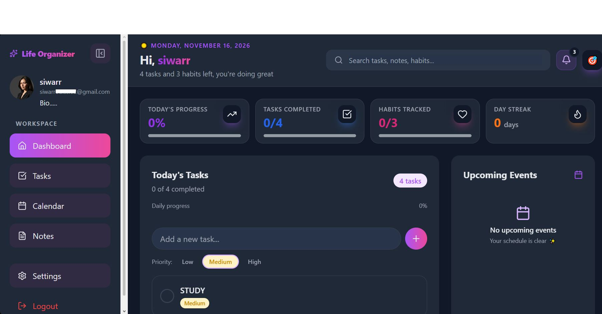
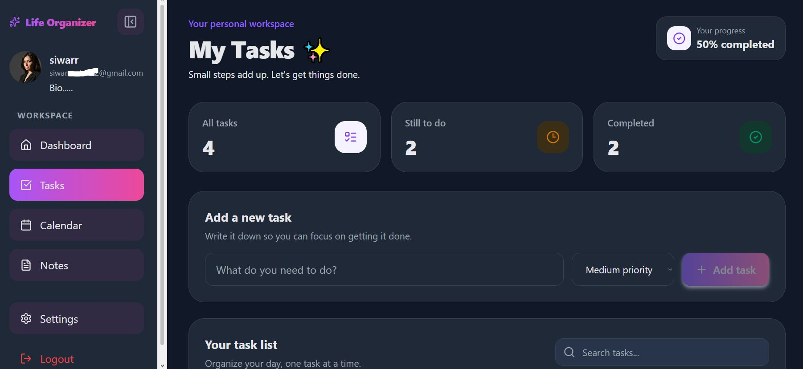
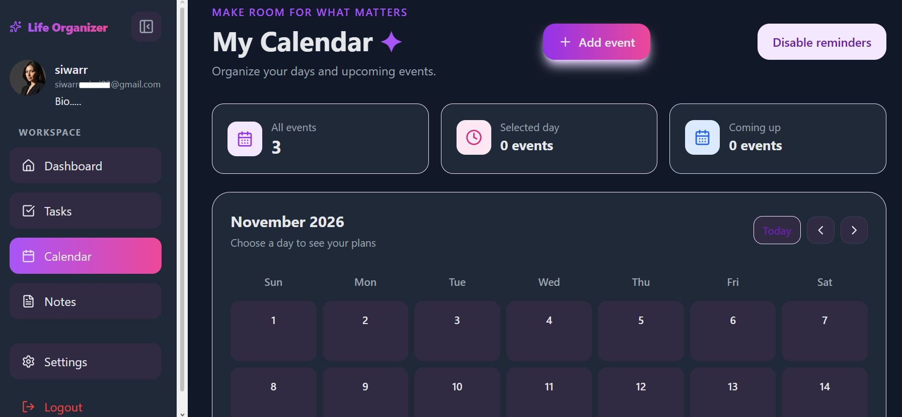
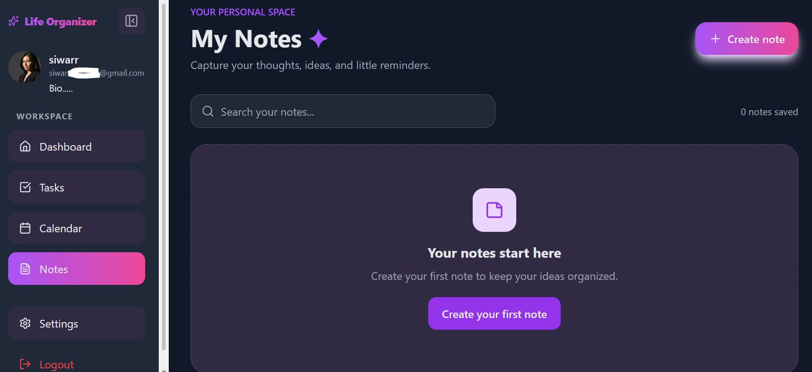
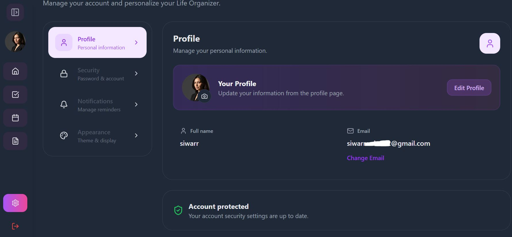
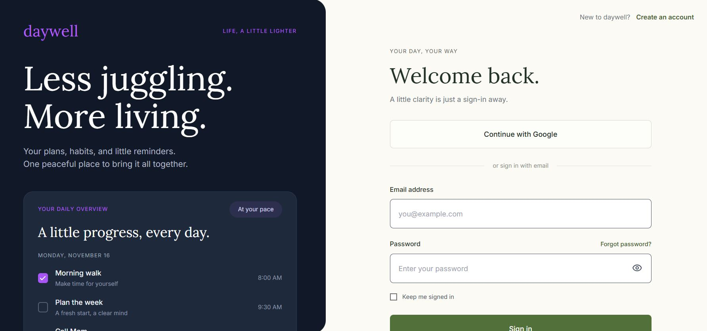

# Life Organizer

A full-stack web application designed to help users organize their daily lives, manage tasks, track habits, and keep important events in one place.

## About the Project

Life Organizer provides a centralized platform for managing everyday activities through a simple and user-friendly interface.

## Features

- **Task Management:** Create, organize, prioritize, complete, and track tasks.
- **Habit Tracking:** Track daily habits and monitor progress and streaks.
- **Calendar & Events:** Manage events and receive reminders.
- **Notifications:** Receive reminders for tasks, habits, and upcoming events.
- **User Authentication:** Register, log in, and securely manage accounts.
- **Profile Settings:** Update personal information, profile picture, and password.
- **Dark & Light Mode:** Switch between different visual themes.

## Screenshots

### Dashboard


### Tasks


### Calendar


### Notes


### Settings


### Login

## Technologies Used

**Frontend**
- React
- Vite
- Tailwind CSS
- Axios

**Backend**
- Node.js
- Express.js
- MongoDB
- Mongoose
- JWT Authentication
- bcrypt

## Project Structure

```text
life-organizer/
├── front/    # React frontend
├── back/     # Node.js and Express backend
└── README.md
```

## Getting Started

### Prerequisites

- Node.js and npm
- MongoDB

### Installation

1. Clone the repository:

```bash
git clone https://github.com/siwar-r07/life-organizer.git
```

2. Install frontend dependencies:

```bash
cd life-organizer/front
npm install
```

3. Install backend dependencies:

```bash
cd ../back
npm install
```

4. Create a `.env` file inside the `back` folder and configure the required environment variables.

### Running the Application

You need two terminals to run the application.

**Terminal 1 – Backend**

```bash
cd life-organizer/back
npm run server
```

**Terminal 2 – Frontend**

```bash
cd life-organizer/front
npm run dev
```

Open the local URL displayed by Vite in your browser.

## Author

Developed as a personal full-stack web development project.